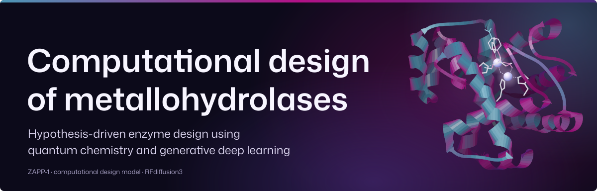
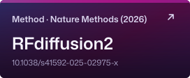
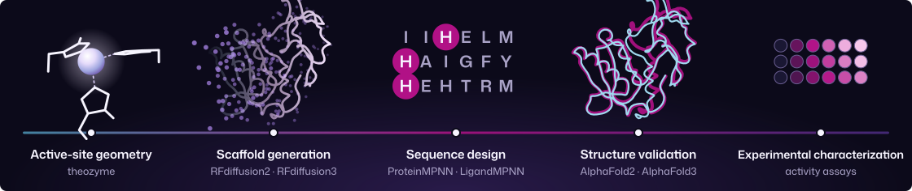
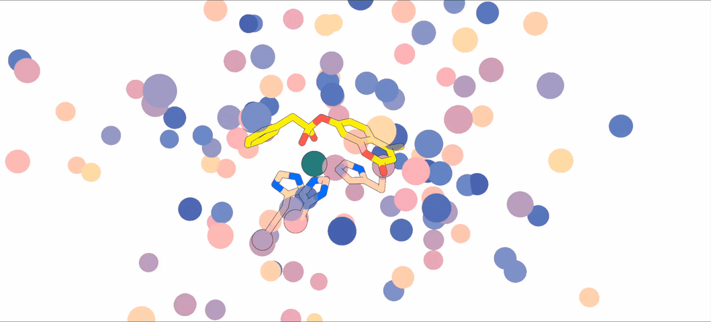
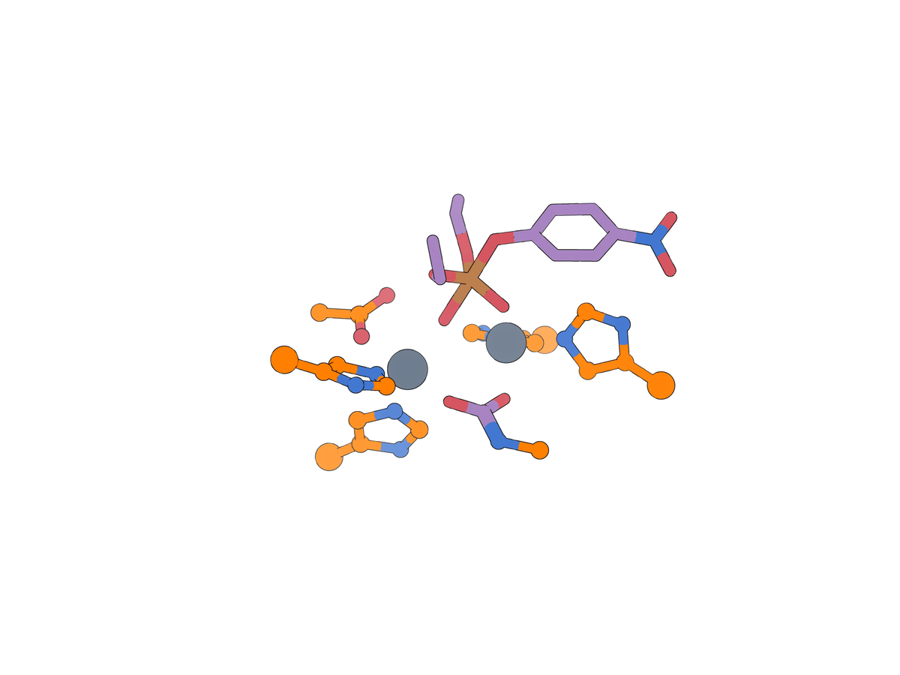

<h1 align="center">
  <picture>
    <source media="(max-width: 640px)" srcset="Docs/assets/readme/masthead-narrow.svg">
    
  </picture>
</h1>

<p align="center">
  Code, tutorials, and experimental data for designing metal-dependent enzymes
  with RFdiffusion2 and RFdiffusion3. It accompanies the metallohydrolase
  study <a href="#ref-1">[1]</a> and contributes enzyme-design examples and data
  to the RFdiffusion2 <a href="#ref-2">[2]</a> and RFdiffusion3 <a href="#ref-3">[3]</a> studies.
</p>

<p align="center">
  <a href="Docs/README.md"></a>&nbsp;<a href="#the-design-pipeline"></a>&nbsp;<a href="Manuscript_Data/README.md"></a>&nbsp;<a href="#citation"></a>
</p>

<p align="center">
  <a href="https://doi.org/10.1038/s41586-025-09746-w"></a>&nbsp;<a href="https://doi.org/10.1038/s41592-025-02975-x"></a>&nbsp;<a href="https://doi.org/10.1126/science.aeh2982"></a>
</p>

<p align="center">
  <a href="Docs/assets/rfdiffusion3-highlight.mp4?raw=true">
    
  </a>
  <br>
  <strong>RFdiffusion3: from catalytic geometry to a protein scaffold</strong>
  <br>
  Phosphotriesterase design around a quantum-chemistry theozyme.
  <br>
  <a href="Docs/assets/rfdiffusion3-highlight.mp4?raw=true">Full-resolution MP4 · 58 seconds</a> · <a href="Docs/media.md">All animations and downloads</a>
</p>

## Start here

| I want to… | Start here |
| :--- | :--- |
| Explore measurements and figures | [Experimental datasets](Manuscript_Data/README.md) |
| Reanalyze data on a CPU | [Quick start](#quick-start) |
| Learn active-site scaffolding | [RFdiffusion2 tutorial](RFdiffusion2_Tutorial/README.md) · [RFdiffusion3 tutorial](RFdiffusion3_Tutorial/README.md) |
| Adapt a design campaign | [Workflows and available drivers](Docs/workflows.md) |
| Configure a workstation or cluster | [Environments](Environment/README.md) · [Software and weights](Docs/software-and-models.md) |

<a id="learn-the-workflow"></a>

## The design pipeline

A **theozyme** specifies catalytic residues, metal ions, and substrate or
transition-state geometry. Diffusion builds a protein scaffold around this
active site; sequence design and validation select candidates for testing.

<p align="center">
  <picture>
    <source media="(max-width: 640px)" srcset="Docs/assets/readme/pipeline-narrow.svg">
    
  </picture>
</p>

Both tutorials cover theozyme preparation from [PDB 1QJI](https://www.rcsb.org/structure/1QJI)
and the ZETA_2 quantum-chemistry example, followed by scaffold generation and
filtering. Campaign notebooks extend into sequence design and validation.

| Notebook | Model-specific steps |
| :--- | :--- |
| [RFdiffusion2](RFdiffusion2_Tutorial/RFdiffusion2_Tutorial_JupyterNotebook.ipynb) | YAML inputs, unindexed catalytic residues, fixed active-site atoms, filtering |
| [RFdiffusion3](RFdiffusion3_Tutorial/RFdiffusion3_Tutorial_JupyterNotebook.ipynb) | Foundry `rfd3 design`, JSON inputs, atom-level conditioning, filtering, geometry idealization |

**RFdiffusion3 learning resources:** [video walkthroughs and official RosettaCommons guides](RFdiffusion3_Tutorial/README.md#learning-resources),
from installation and motif scaffolding to advanced enzyme design.

<table>
  <tr>
    <th>RFdiffusion2 · Scaffold generation</th>
    <th>RFdiffusion3 · Active-site and scaffold detail</th>
  </tr>
  <tr>
    <td width="60%" align="center" valign="middle">
      <a href="Docs/assets/rfdiffusion2-scaffold-generation.mp4?raw=true">
        
      </a>
    </td>
    <td width="40%" align="center" valign="middle">
      <a href="Docs/assets/rfdiffusion3-supplementary.gif">
        
      </a>
    </td>
  </tr>
  <tr>
    <td align="center"><a href="Docs/assets/rfdiffusion2-scaffold-generation.mp4?raw=true">Cropped MP4 · 5.77 seconds</a><br><a href="Docs/assets/rfdiffusion2-scaffold-generation-original.mp4?raw=true">Original MP4</a></td>
    <td align="center"><a href="Docs/assets/rfdiffusion3-supplementary.gif">Cropped GIF · 11 seconds</a><br><a href="Docs/assets/rfdiffusion3-supplementary-original.gif">Original GIF</a></td>
  </tr>
</table>

These animations are computational design trajectories, not experimental structures.

## Explore the data

| Dataset | Publication | Available design material |
| :--- | :--- | :--- |
| [Metallohydrolases: phenylacetate hydrolysis](Manuscript_Data/Metallohydrolase_Nature_2026/README.md) | *Nature* [[1]](#ref-1) | [RFdiffusion2 driver and outputs](Design_Pipelines/Metalloesterase_RFdiffusion2/README.md) |
| [Additional metalloesterases: 4MU-butyrate](Manuscript_Data/Metallohydrolase_RFdiffusion2_Nature_Methods_2026/README.md) | *Nature Methods* [[2]](#ref-2) | Shared RFdiffusion2 campaign |
| [Phosphotriesterases: paraoxon hydrolysis](Manuscript_Data/Phosphotriesterase_RFdiffusion3_Science_2026/README.md) | *Science* [[3]](#ref-3) | [RFdiffusion3 driver and inputs](Design_Pipelines/Phosphotriesterase_RFdiffusion3/README.md); production outputs not deposited |
| [Metalloproteases: amide hydrolysis](Manuscript_Data/Metalloprotease_RFdiffusion3_Science_2026/README.md) | *Science* [[3]](#ref-3) | [Campaign placeholder](Design_Pipelines/Metalloprotease_RFdiffusion3/README.md); driver not deposited |

Each dataset has a `wetlab_data_analysis.py` marimo app. See
[data and reproduction](Docs/data-and-reproduction.md) for assay coverage,
figure exports, and the distinction between fresh fits and historical figures.

**Related derivative work:** Chen *et al.* [[4]](#ref-4) reports designed metalloproteases
and applications in selective protein cleavage and caged biomodulator activation.
Its code and data have a separate [Zenodo deposit](https://doi.org/10.5281/zenodo.22654831).

## Quick start

### Analyze experimental data

```bash
git clone https://github.com/baker-laboratory/Metallohydrolase_Enzyme_Design.git
cd Metallohydrolase_Enzyme_Design
conda env create -f Environment/analysis.yml
conda activate zinc_hydro_analysis
marimo edit Manuscript_Data/Metallohydrolase_Nature_2026/wetlab_data_analysis.py
```

> [!NOTE]
> The analysis path needs no GPU, model weights, or software submodules:
> [Python 3.10–3.12 on a CPU](Environment/README.md#cpu-manuscript-analysis).
> Change the dataset path to open another app.
> [Other installation options](Docs/getting-started.md).

### Run design workflows

```bash
git submodule update --init --recursive
```

Follow the [environment guide](Environment/README.md): `zinc_hydro` provides
Linux/NVIDIA helper tools; inference models require separate environments and
checkpoints. After setup, inspect helper and ligand-tool resolution:

```bash
python Scripts/env_config.py
python Scripts/repo_paths.py
```

Review model launchers, output paths, container mounts, and scheduler settings
before running notebook cells or jobs. See the [workflow guide](Docs/workflows.md).

## Repository guide

| Directory | Contents |
| :--- | :--- |
| [Docs](Docs/README.md) | Setup, workflows, reproduction, software, and references |
| [Environment](Environment/README.md) | Analysis/helper specifications and container recipes |
| [RFdiffusion2 tutorial](RFdiffusion2_Tutorial/README.md) · [RFdiffusion3 tutorial](RFdiffusion3_Tutorial/README.md) | Teaching notebooks and inputs |
| [Design_Pipelines](Design_Pipelines/README.md) | Campaign drivers and computational deposits |
| [Manuscript_Data](Manuscript_Data/README.md) | Measurements, supplementary deposits, analysis apps, and figures |
| [Scripts](Scripts/) · [Software](Software/) | Shared utilities and pinned third-party tools |

[Detailed repository map](Docs/repository-map.md).

## Citation

Cite the studies corresponding to the methods and data you use.
**[Download BibTeX (.bib)](Docs/references.bib)** ·
[Citation guide](Docs/citations.md) · [CITATION.cff](CITATION.cff).

1. <a id="ref-1"></a>Kim, D., Woodbury, S. M., Ahern, W. *et al.* Computational design of metallohydrolases. *Nature* **649**, 246–253 (2026). [DOI](https://doi.org/10.1038/s41586-025-09746-w).
2. <a id="ref-2"></a>Ahern, W., Yim, J., Tischer, D. *et al.* Atom-level enzyme active site scaffolding using RFdiffusion2. *Nature Methods* **23**, 96–105 (2026). [DOI](https://doi.org/10.1038/s41592-025-02975-x).
3. <a id="ref-3"></a>Butcher, J., Krishna, R., Mitra, R. *et al.* Atomic functional site scaffolding in biopolymers with RFdiffusion3. *Science*, eaeh2982 (2026). [DOI](https://doi.org/10.1126/science.aeh2982).
4. <a id="ref-4"></a>Chen, A., Wu, K., Choi, H. *et al.* Computational design of metalloproteases. *Nature* (2026). [DOI](https://doi.org/10.1038/s41586-026-11167-2). **Related derivative work; separate data deposit.**

<details>
<summary><strong>Copy BibTeX citations</strong></summary>

```bibtex
@article{kim2026metallohydrolases,
  title     = {Computational design of metallohydrolases},
  author    = {Kim, Donghyo and
               Woodbury, Seth M. and
               Ahern, Woody and
               Tischer, Doug and
               Kang, Alex and
               Joyce, Emily and
               Bera, Asim K. and
               Hanikel, Nikita and
               Salike, Saman and
               Krishna, Rohith and
               Yim, Jason and
               Pellock, Samuel J. and
               Lauko, Anna and
               Kalvet, Indrek and
               Hilvert, Donald and
               Baker, David},
  journal   = {Nature},
  year      = {2026},
  volume    = {649},
  number    = {8095},
  pages     = {246--253},
  doi       = {10.1038/s41586-025-09746-w},
  url       = {https://doi.org/10.1038/s41586-025-09746-w}
}

@article{ahern2026rfdiffusion2,
  title     = {Atom-level enzyme active site scaffolding using {RFdiffusion2}},
  author    = {Ahern, Woody and
               Yim, Jason and
               Tischer, Doug and
               Salike, Saman and
               Woodbury, Seth M. and
               Kim, Donghyo and
               Kalvet, Indrek and
               Kipnis, Yakov and
               Coventry, Brian and
               Altae-Tran, Han Raut and
               Bauer, Magnus S. and
               Barzilay, Regina and
               Jaakkola, Tommi S. and
               Krishna, Rohith and
               Baker, David},
  journal   = {Nature Methods},
  year      = {2026},
  volume    = {23},
  number    = {1},
  pages     = {96--105},
  doi       = {10.1038/s41592-025-02975-x},
  url       = {https://doi.org/10.1038/s41592-025-02975-x}
}

@article{butcher2026rfdiffusion3,
  title     = {Atomic functional site scaffolding in biopolymers with {RFdiffusion3}},
  author    = {Butcher, Jasper and
               Krishna, Rohith and
               Mitra, Raktim and
               Woodbury, Seth M. and
               Kim, Donghyo and
               Brent, Rafael I. and
               Li, Yanjing and
               Corley, Nathaniel and
               Favor, Andrew and
               Chen, Anqi and
               Kim, Paul T. and
               Funk, Jonathan and
               Reinoso, Gabriela Bastidas and
               Wu, Kejia and
               Muraishi, Aiko and
               Eisenach, Helen E. and
               Salike, Saman and
               Mathis, Simon and
               Thompson, Tuscan Rock and
               Ruder, Antonia and
               Sehgal, Enisha and
               Kubaney, Andrew and
               Chen, Jie and
               Politanska, Yuliya and
               Coventry, Brian and
               Zhang, Odin and
               Hardy, Florence J. and
               Qiang, Bo and
               Didi, Kieran and
               Kazman, Maxwell and
               Schaaf, Lars L. and
               DiMaio, Frank and
               Baker, David},
  journal   = {Science},
  year      = {2026},
  pages     = {eaeh2982},
  doi       = {10.1126/science.aeh2982},
  url       = {https://doi.org/10.1126/science.aeh2982}
}

% Related derivative work; published online 2026-10-14 without assigned volume, issue or pages.
@article{chen2026metalloproteases,
  title     = {Computational design of metalloproteases},
  author    = {Chen, Anqi and
               Wu, Kejia and
               Choi, Hojae and
               Venkatesh, Preetham and
               Pellock, Samuel J. and
               Hanikel, Nikita and
               shin, Hojeong and
               Evans, Declan and
               Didi, Kieran and
               Schaaf, Lars L. and
               Díaz-Perlas, Cristina and
               Coventry, Brian and
               Kim, Donghyo and
               Woodbury, Seth M. and
               Ji, Pengfei and
               Honda, Shingo and
               Bera, Asim K. and
               Nguyen, Hannah and
               Kang, Alex and
               Wang, Yanqing and
               Li, Xinting and
               Gerben, Stacey and
               Chang, Lemuel and
               Yan, Xiao and
               Oller-Salvia, Benjamí and
               Hyman, Anthony A. and
               Hilvert, Donald and
               Baker, David},
  journal   = {Nature},
  year      = {2026},
  doi       = {10.1038/s41586-026-11167-2},
  url       = {https://doi.org/10.1038/s41586-026-11167-2}
}
```

</details>

## Contributing and contact

[Open an issue](https://github.com/baker-laboratory/Metallohydrolase_Enzyme_Design/issues)
with the failing command, error, and environment details.
[Contributor guide](Docs/contributing.md) · [Agent guidance](AGENTS.md).

**Scientific contacts:** [Seth M. Woodbury](mailto:woodbuse@uw.edu) · [Donghyo Kim](mailto:donghyo@uw.edu).

Original project code uses the **[MIT License](LICENSE)**. Third-party software
and model parameters retain their [own terms](Docs/software-and-models.md#licensing).

<p align="center"></p>
